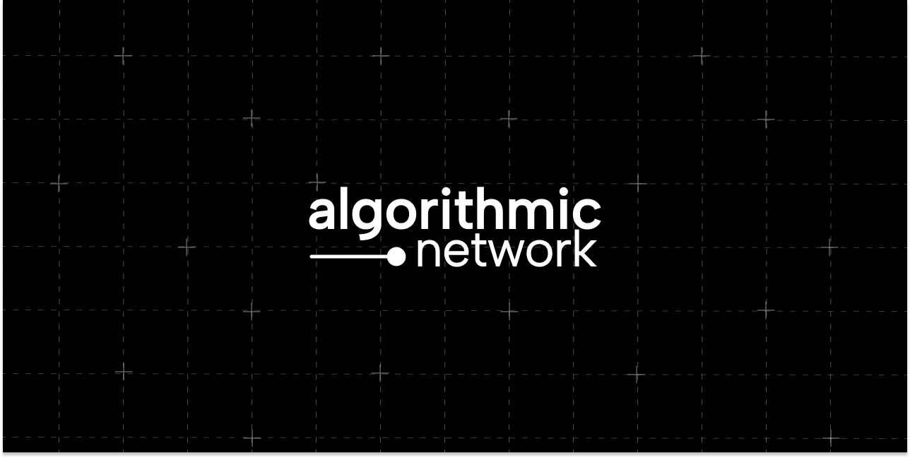

  
   
  

 

<!-- Socials -->

  
  &nbsp;&nbsp;&nbsp;
  
  &nbsp;&nbsp;&nbsp;
  

---

## 💡 About Us

  At <strong>Algorithmic Network</strong>, we are a collective of passionate engineers, designers, and strategists dedicated to building a safer, more transparent digital future. We don't just write code; we architect trust. From cutting-edge enterprise applications to robust security consulting, we deliver solutions that empower our clients and protect their users.

## 🚀 Our Services
<table width="100%" border="0" cellpadding="0" cellspacing="0">
  <tr valign="top">
    <td width="32%">
      <table width="100%" border="0" cellpadding="15" style="background-color: #161b22; border: 1px solid #30363d; border-radius: 6px; height: 100%;">
        <tr>
          <td align="center" valign="top">
            <h3 style="font-size: 1.5em; margin-bottom: 0.5em;">📦</h3>
            <h3 style="color: #6a64e3;">Bespoke Products</h3>
            
We craft high-quality software products tailored for enterprise needs, focusing on scalability, security, and user-centric design.

          </td>
        </tr>
      </table>
    </td>
    <td width="2%">&nbsp;</td>
    <td width="32%">
       <table width="100%" border="0" cellpadding="15" style="background-color: #161b22; border: 1px solid #30363d; border-radius: 6px; height: 100%;">
        <tr>
          <td align="center" valign="top">
            <h3 style="font-size: 1.5em; margin-bottom: 0.5em;">💻</h3>
            <h3 style="color: #6a64e3;">Custom Development</h3>
            
Our team partners with you to build custom applications from the ground up, turning your unique vision into a secure and powerful reality.

          </td>
        </tr>
      </table>
    </td>
    <td width="2%">&nbsp;</td>
    <td width="32%">
       <table width="100%" border="0" cellpadding="15" style="background-color: #161b22; border: 1px solid #30363d; border-radius: 6px; height: 100%;">
        <tr>
          <td align="center" valign="top">
            <h3 style="font-size: 1.5em; margin-bottom: 0.5em;">🤝</h3>
            <h3 style="color: #6a64e3;">IT Consultation</h3>
            
Leverage our expertise to navigate complex tech landscapes. We provide strategic guidance on security, architecture, and digital transformation.

          </td>
        </tr>
      </table>
    </td>
  </tr>
</table>

## ✨ Our Core Principles

Our four pillars guide everything we build.

<table width="100%" border="0" cellpadding="0" cellspacing="0">
  <tr valign="top">
    <td width="23%">
      <table width="100%" border="0" cellpadding="15" style="background-color: #161b22; border: 1px solid #30363d; border-radius: 6px; height: 100%;">
        <tr>
          <td align="center" valign="top">
            <h4 style="font-size: 1.5em; margin-bottom: 0.5em;">🔒</h4>
            <h4 style="color: #6a64e3;">Privacy First</h4>
            
We champion data privacy as a human right, embedding it into the core of our development lifecycle.

          </td>
        </tr>
      </table>
    </td>
    <td width="2%">&nbsp;</td>
    <td width="23%">
       <table width="100%" border="0" cellpadding="15" style="background-color: #161b22; border: 1px solid #30363d; border-radius: 6px; height: 100%;">
        <tr>
          <td align="center" valign="top">
            <h4 style="font-size: 1.5em; margin-bottom: 0.5em;">🛡️</h4>
            <h4 style="color: #6a64e3;">Ironclad Security</h4>
            
We build resilient, hardened systems designed to withstand and repel the sophisticated threats of the modern web.

          </td>
        </tr>
      </table>
    </td>
    <td width="2%">&nbsp;</td>
    <td width="23%">
       <table width="100%" border="0" cellpadding="15" style="background-color: #161b22; border: 1px solid #30363d; border-radius: 6px; height: 100%;">
        <tr>
          <td align="center" valign="top">
            <h4 style="font-size: 1.5em; margin-bottom: 0.5em;">🔍</h4>
            <h4 style="color: #6a64e3;">Radical Transparency</h4>
            
We believe in open communication. Our clients and users have a right to understand the logic that powers their tools.

          </td>
        </tr>
      </table>
    </td>
    <td width="2%">&nbsp;</td>
    <td width="23%">
       <table width="100%" border="0" cellpadding="15" style="background-color: #161b22; border: 1px solid #30363d; border-radius: 6px; height: 100%;">
        <tr>
          <td align="center" valign="top">
            <h4 style="font-size: 1.5em; margin-bottom: 0.5em;">🔑</h4>
            <h4 style="color: #6a64e3;">Total Encryption</h4>
            
Your data is yours alone. We use state-of-the-art encryption to ensure it stays that way, both in transit and at rest.

          </td>
        </tr>
      </table>
    </td>
  </tr>
</table>

---

  <h2>🛠️ Our Tech Stack</h2>
  

    We believe in using the right tool for the job. Our team is proficient in a wide range of modern technologies, including:
      
    
    
    
    
    
    
    
     
    
    
    
    
    
    
    
     
    
    
    
    
    
    
     
    
    
    
    
  

---

  <h2>📫 Let's Build the Future Together</h2>
  
Have an idea or a challenge? We'd love to hear from you.

  

