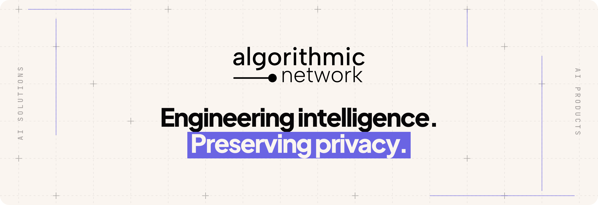
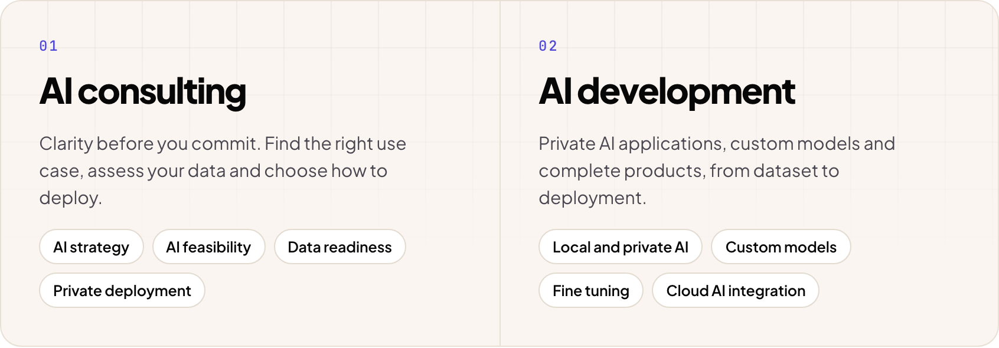
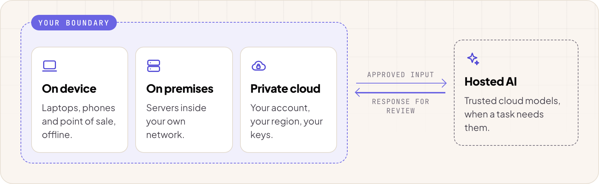
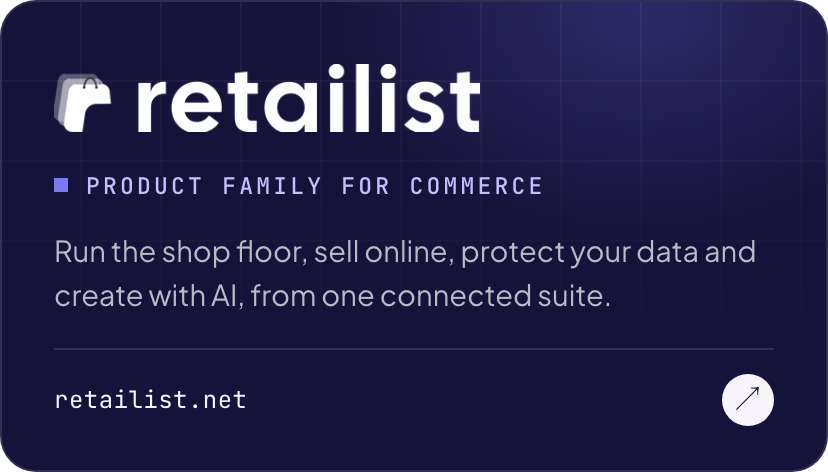
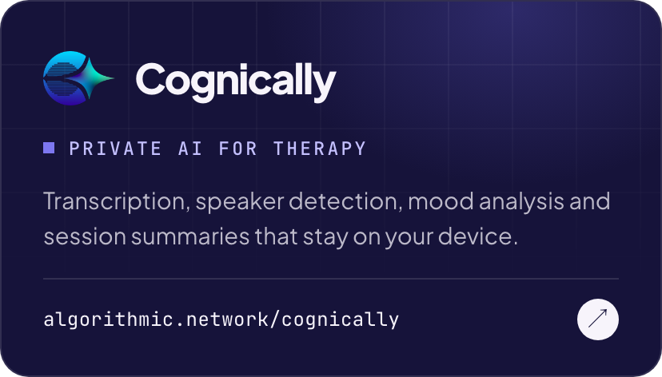
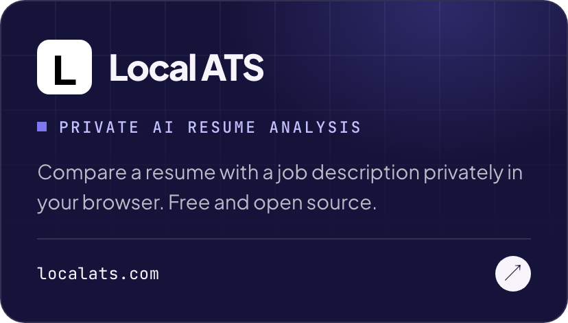
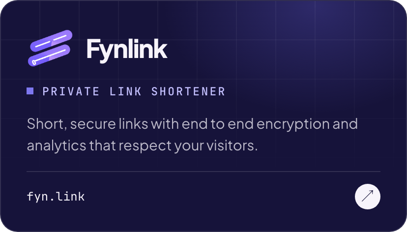

<picture>
  <source media="(prefers-color-scheme: dark)" srcset="banner-dark.png">
  
</picture>

  <a href="https://algorithmic.network">Website</a>&nbsp;&nbsp;·&nbsp;&nbsp;<a href="https://x.com/AlgorithmicHQ">X</a>&nbsp;&nbsp;·&nbsp;&nbsp;<a href="https://huggingface.co/algorithmicnetwork">Hugging Face</a>&nbsp;&nbsp;·&nbsp;&nbsp;<a href="mailto:hello@algorithmic.network">hello@algorithmic.network</a>

### Most AI begins by asking for your data. We begin by asking where it should stay.

Algorithmic Network designs and builds private AI: custom solutions, models and products that run on your devices, inside your own network or in a private cloud, and connect to trusted hosted models only when they are the better fit.

<picture>
  <source media="(prefers-color-scheme: dark)" srcset="services-dark.png">
  
</picture>

### Local first. Cloud when it helps.

<picture>
  <source media="(prefers-color-scheme: dark)" srcset="deploy-dark.png">
  
</picture>

### Our products

  
  
  
  

  <strong>Private by default</strong>&nbsp;&nbsp;·&nbsp;&nbsp;<strong>Measured on real tasks</strong>&nbsp;&nbsp;·&nbsp;&nbsp;<strong>People stay in charge</strong>&nbsp;&nbsp;·&nbsp;&nbsp;<strong>Plain language</strong>

---

  Have an AI idea or a product in mind? A short call is usually enough to find the right first step. 
  <a href="mailto:hello@algorithmic.network">hello@algorithmic.network</a>&nbsp;&nbsp;·&nbsp;&nbsp;<a href="https://algorithmic.network">algorithmic.network</a>

